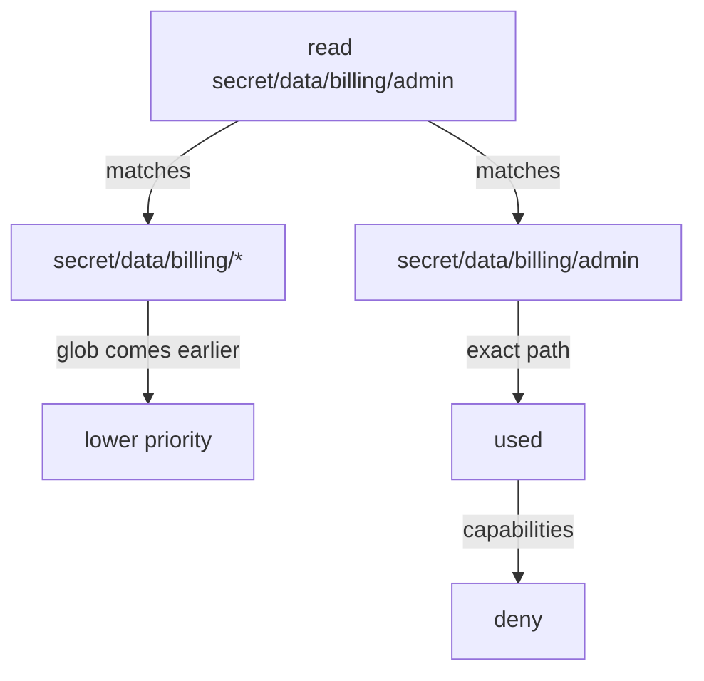

# How OpenBao Matches A Request To A Rule

A real policy has many rules, and a token often has several policies. For one request, several rules can match at the same time: a wide rule for a whole team and a narrow rule for one secret. OpenBao does not add their capabilities together. It picks one rule and uses only that rule's capabilities. This part shows how it picks, and how `deny` overrides everything.

## Globs and the plus segment

Two characters make a path rule match more than one path. A **glob**, `*`, may appear only at the end of a path and matches any text after it, including more slashes. A **plus**, `+`, matches exactly one path segment, the text between two slashes, and may appear anywhere.

| Rule path | Matches | Does not match |
| --- | --- | --- |
| `secret/data/inventory/*` | `secret/data/inventory/db`, `secret/data/inventory/a/b` | `secret/data/inventory` |
| `secret/data/inv*` | `secret/data/inventory/db`, `secret/data/invoices` | `secret/data/billing/db` |
| `secret/data/+/reports` | `secret/data/inventory/reports`, `secret/data/billing/reports` | `secret/data/a/b/reports` |
| `secret/data/+/+/reports` | `secret/data/a/b/reports` | `secret/data/billing/reports` |

The second row is a common surprise: `inv*` matches every path that starts with those letters, not only the `inventory` folder. A `*` in the middle of a path is not a glob at all: OpenBao only treats `*` as a glob at the end of a path. A rule on `secret/data/*/reports` therefore does not match `secret/data/inventory/reports`, and the team that wrote it gets `permission denied`.

## Which rule wins

When several rules match one request, OpenBao uses the most specific one. If the same path pattern appears in more than one policy on the token, it combines the capabilities of those identical patterns. If the patterns differ, only the highest-priority pattern counts. OpenBao compares two matching patterns with these rules, in this order:

1. The pattern whose first `+` or `*` comes later wins.
2. A pattern that does not end in `*` wins over one that does.
3. The pattern with fewer `+` segments wins.
4. The longer pattern wins.
5. The pattern that sorts later as text wins.

In practice, an exact path beats a glob, and a longer glob beats a shorter one. The diagram shows how OpenBao decides one request to `secret/data/billing/admin` when two rules match:



The diagram shows that the exact rule wins, so its capabilities, here `deny`, decide the request.

## Deny beats everything

`deny` is a capability that refuses the request. It wins even over `sudo`, and even when another policy on the same token would allow the request. Its main use is to cut one path out of a wider rule.

<!-- astrona:playground:renew -->

The billing application may read every billing secret except the administrator password. Save this as `billing-read.hcl`:

```hcl
path "secret/data/billing/*" {
  capabilities = ["read"]
}

# The administrator password stays with the operators.
path "secret/data/billing/admin" {
  capabilities = ["deny"]
}
```

Load it, create a token that has only this policy, and try both secrets:

```sh
bao policy write billing-read billing-read.hcl
APP_TOKEN=$(bao token create -policy=billing-read -ttl=15m -field=token)
BAO_TOKEN=$APP_TOKEN bao kv get secret/billing/db
BAO_TOKEN=$APP_TOKEN bao kv get secret/billing/admin
```

The database secret is returned, and the administrator secret fails with `permission denied`. The exact rule on `secret/data/billing/admin` has higher priority than the glob, and its capability is `deny`.

The same priority rules make a mistake hard to see. If the `deny` rule names `secret/data/billing/db` by accident, the application loses the one secret it needs, while every other billing secret still works. The policy reads as if it protects the administrator password, but it blocks the wrong path.

## The plus segment in practice

A reporting job reads the `reports` secret of every team, and nothing else. A glob cannot express this, because it can only end a path. A `+` can. Save this as `reports.hcl`:

```hcl
path "secret/data/+/reports" {
  capabilities = ["read"]
}
```

Load it and test it against a reports secret and a database secret:

```sh
bao policy write reports reports.hcl
REPORT_TOKEN=$(bao token create -policy=reports -ttl=15m -field=token)
BAO_TOKEN=$REPORT_TOKEN bao kv get secret/inventory/reports
BAO_TOKEN=$REPORT_TOKEN bao kv get secret/inventory/db
```

The reports secret is returned and the database secret is refused. The `+` matched `inventory`, one segment, and nothing else.

You now know how OpenBao chooses one rule from many, how `deny` cuts a path out of a wider rule, and why a `+` can do what a glob in the middle of a path cannot. What is still open is how to check a policy without writing a test for every path by hand, and how to limit not only where a request goes but what it sends.

## Common pitfalls

> [!WARNING]
> - **Expecting capabilities from different patterns to add up.** Only the highest-priority matching pattern counts. A narrow rule with `read` hides a wider rule with `list` for that path.
> - **Putting `*` in the middle of a path.** It is not a glob there. Use `+` for one segment.
> - **A short glob that matches too much.** `secret/data/inv*` also matches `secret/data/invoices`. End the prefix with a slash: `secret/data/inventory/*`.
> - **A `deny` on the wrong path.** It removes the path silently while everything else keeps working. Test the paths the application needs, not only the one you meant to block.
