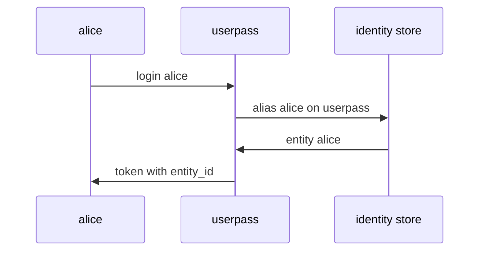

# Templated Policies From Identity

A team wants every member to have a private folder of secrets under `secret/users/<name>/`. Writing one policy per person works for three people and breaks down at thirty. A **templated policy** solves this with one policy: its paths contain placeholders that OpenBao fills in from the caller's identity at the moment of each request. This part shows where that identity comes from and how to write the template.

## From a login to an entity

When a user logs in, the auth method checks the credentials and OpenBao creates a token. OpenBao also looks for an **alias**, a record that says "the user name `alice` on this userpass mount belongs to this entity". The **identity entity** behind the alias is the one OpenBao uses for identity templates and group membership.



The diagram shows that the token OpenBao returns carries the ID of the entity the alias points to.

<!-- astrona:playground:renew -->

Log in as `alice` and read the token's identity. The `-token-only` flag prints only the token, and `-no-store` keeps it out of the token helper file, so your shell keeps the root token:

```sh
ALICE=$(bao login -method=userpass -token-only -no-store username=alice password=alice-password)
BAO_TOKEN=$ALICE bao token lookup
```

The output has an `entity_id` field. Look up that entity as the root user:

```sh
bao read identity/entity/name/alice
```

The entity is named `alice`, and its `aliases` list holds one alias with the name `alice` and the accessor of the userpass mount. The environment created these entities and aliases ahead of time. Without them, OpenBao creates an entity on the first login with a generated name such as `entity_6a2f...`, which makes a name-based template useless.

## Writing the template

A template is written inside a path with double braces. OpenBao offers several parameters; the most common are:

| Parameter | What OpenBao fills in |
| --- | --- |
| `identity.entity.id` | The entity's ID |
| `identity.entity.name` | The entity's name |
| `identity.entity.metadata.<key>` | A metadata value on the entity |
| `identity.entity.aliases.<mount accessor>.name` | The alias name on one auth mount |
| `identity.groups.names.<group name>.id` | The ID of a named group |

The entity ID never changes and is never reused, so the OpenBao documentation recommends IDs where you can. Names are easier to read, and this course uses them because the entities have fixed names.

Save this as `personal-kv.hcl`:

```hcl
# Each user may manage the secrets in their own folder.
path "secret/data/users/{{identity.entity.name}}/*" {
  capabilities = ["create", "read", "update", "patch", "delete"]
}

# Each user may list their own folder.
path "secret/metadata/users/{{identity.entity.name}}/*" {
  capabilities = ["list"]
}
```

Load it, and for now attach it to `alice` and `bob` directly through their userpass users:

```sh
bao policy write personal-kv personal-kv.hcl
bao write auth/userpass/users/alice token_policies=personal-kv
bao write auth/userpass/users/bob token_policies=personal-kv
```

The `token_policies` setting is read at login, so log in again and test both users:

```sh
ALICE=$(bao login -method=userpass -token-only -no-store username=alice password=alice-password)
BAO_TOKEN=$ALICE bao kv put secret/users/alice/notes text="alice's notes"
BAO_TOKEN=$ALICE bao kv get secret/users/alice/notes
BAO_TOKEN=$ALICE bao kv get secret/users/bob/notes
```

The write and the read in `alice`'s folder succeed. The read of `bob`'s notes fails with `permission denied`: for `alice`, the rule's path became `secret/data/users/alice/*`, and `secret/data/users/bob/notes` does not match it.

You now know how a login becomes an entity, and how one templated policy gives every entity its own path. Attaching the policy to each user still does not scale, and it leaves no single place to see who has it. That is the job of identity groups.

## Common pitfalls

> [!WARNING]
> - **Templating on a name the entity does not have.** An entity created at first login gets a generated name. Create entities with known names, or template on `identity.entity.id`.
> - **Templating the `data/` path but not the `metadata/` path.** The user can read and write but cannot list their own folder.
> - **Testing with the root token.** The root policy ignores the template; test with each user's own token.
> - **Expecting `token_policies` changes to reach an existing token.** They are read at login. Log in again after you change them.
