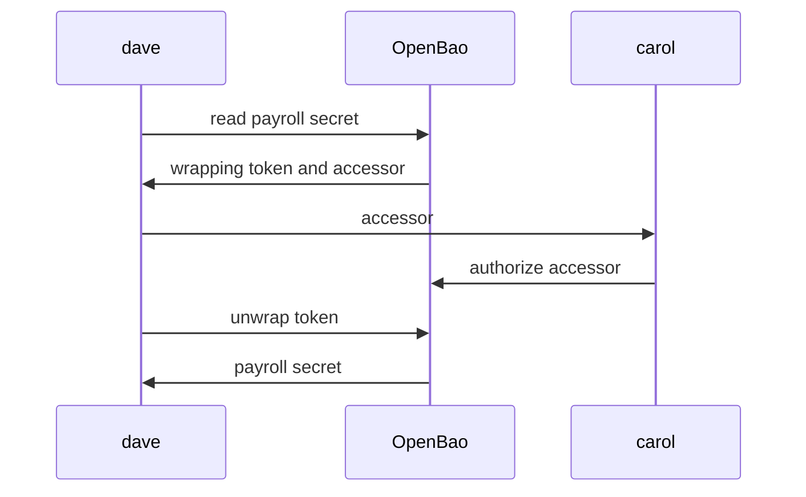

# Control Groups: A Second Person Approves

Some secrets are too sensitive for one person to read alone: payroll data, a root certificate key, production database credentials. Policies alone cannot express "only after someone else agrees". A **control group** can. It is a `control_group` stanza on a policy rule that holds the request until enough members of named identity groups approve it. This part writes one and runs the whole flow.

## How the flow works

When a request hits a path with a control group factor, OpenBao does not run it. It stores a copy of the request and returns a **wrapping token** instead: a single-use token with an accessor, a time to live (TTL) and the original path. The requester sends the accessor to an approver. OpenBao does not notify anybody by itself.



The diagram shows that the secret only leaves OpenBao when the requester unwraps the token after the approval.

The approver can review the stored request first with `sys/control-group/request`, which shows the path, the operation, the requesting entity and the approvals so far. `sys/control-group/authorize` adds an approval. Unwrapping before enough approvals have arrived does not release the data.

## Writing the factor

A factor lives inside a path rule. Each factor names identity groups whose members may approve, and how many approvals it needs:

| Field | What it does |
| --- | --- |
| `factor "<name>"` | One condition; every factor in a rule must be met |
| `identity { group_names = [...] }` | Members of these groups may approve |
| `approvals` | How many different members must approve |
| `self_authorization` | Whether the requester may approve their own request; default `false` |
| `controlled_capabilities` | Only these capabilities need approval; without it, every capability on the path does |
| `ttl` on the `control_group` | How long the wrapping token and the approval stay valid |

OpenBao's control groups check identity groups only. The capabilities in `controlled_capabilities` must also appear in the rule's own `capabilities` list.

<!-- astrona:playground:renew -->

Create two groups for the exercise: `payroll` with `dave`, and `approvers` with `carol`. The group commands need entity IDs, which this helper looks up by name:

```sh
entity_id() { bao read -field=id "identity/entity/name/$1"; }
bao write identity/group name=payroll member_entity_ids="$(entity_id dave)"
bao write identity/group name=approvers member_entity_ids="$(entity_id carol)"
```

Save this as `payroll-read.hcl`:

```hcl
path "secret/data/payroll/*" {
  capabilities = ["read"]
  control_group = {
    factor "payroll-approval" {
      identity {
        group_names = ["approvers"]
        approvals   = 1
      }
    }
  }
}
```

Load it and attach it to the group `payroll`:

```sh
bao policy write payroll-read payroll-read.hcl
bao write identity/group/name/payroll policies=payroll-read
```

## Running the flow

Log in as `dave` and read the payroll secret:

```sh
DAVE=$(bao login -method=userpass -token-only -no-store username=dave password=dave-password)
BAO_TOKEN=$DAVE bao kv get secret/payroll/salaries
```

There is no secret in the output. Instead, `bao` prints a wrapping token, its accessor, its TTL and the creation path `secret/data/payroll/salaries`. Copy the accessor and the token into variables; the values below are placeholders:

```sh
WRAPPING_TOKEN=<WRAPPING_TOKEN>
WRAPPING_ACCESSOR=<WRAPPING_ACCESSOR>
```

Now act as `carol`: review the request, then approve it.

```sh
CAROL=$(bao login -method=userpass -token-only -no-store username=carol password=carol-password)
BAO_TOKEN=$CAROL bao write sys/control-group/request accessor="$WRAPPING_ACCESSOR"
BAO_TOKEN=$CAROL bao write sys/control-group/authorize accessor="$WRAPPING_ACCESSOR"
```

The review shows `approved` as `false`, the request path, the operation and `dave`'s entity. After the authorize call, `approved` is `true`. Finally, `dave` unwraps:

```sh
BAO_TOKEN=$DAVE bao unwrap "$WRAPPING_TOKEN"
```

The output is the original KV response with the salaries. The wrapping token is now used up; a second unwrap fails.

You now know how a control group holds a request, who may approve it, and how the requester collects the result. A control group is only as good as its groups: a factor that names a group that does not exist, or a group with no members, can never be approved, and a policy on too wide a group lets too many people ask.

## Common pitfalls

> [!WARNING]
> - **A group name in the factor that does not exist.** Nothing checks it when you write the policy. Every request then waits forever. Compare `group_names` with `bao list identity/group/name`.
> - **An empty approvers group.** Same result: nobody can approve.
> - **Approving your own request.** With `self_authorization` at its default, `false`, a member of both groups cannot approve their own request; ask another member.
> - **Expecting a notification.** OpenBao does not tell approvers about pending requests. Send the accessor yourself.
