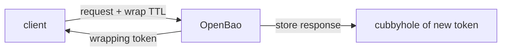

# Response Wrapping

When OpenBao returns a secret, everything that touches the response can read it: the program that asked, its logs, and anything it passes the secret to. Often the program that asks is not the one that uses the secret. A deployment pipeline fetches credentials for an application it starts. **Response wrapping** lets the asker carry the secret without being able to read it. This part shows what OpenBao does and how to use it.

## What OpenBao does when you ask for wrapping

A client asks for wrapping by sending a time to live (TTL) with the request: the `-wrap-ttl` flag in the `bao` command, or the `X-Vault-Wrap-TTL` header in the HTTP API. OpenBao then runs the request as usual, but does not return the response. It takes these steps:

1. It serializes the original response.
2. It creates a new single-use token with the TTL the client asked for.
3. It stores the serialized response in that token's **cubbyhole**, a private storage area that only that token can reach.
4. It returns a wrap information object instead of the response.



The diagram shows that the response stays inside OpenBao, in the cubbyhole of the new token, and the client only receives that token.

The wrap information object has these fields:

| Field | What it is |
| --- | --- |
| `token` | The wrapping token itself |
| `accessor` | An identifier for the token that cannot be used to unwrap it |
| `ttl` | How long the wrapping token is valid |
| `creation_time` | When OpenBao created it |
| `creation_path` | The API path of the original request |
| `wrapped_accessor` | When the wrapped response contains a token, that token's accessor |

## Wrapping and unwrapping a secret

<!-- astrona:playground:renew -->

Read the inventory database secret, but wrapped for five minutes:

```sh
bao kv get -wrap-ttl=5m secret/inventory/db
```

The output shows no username or password. It shows `wrapping_token`, `wrapping_accessor`, `wrapping_token_ttl` and `wrapping_token_creation_path`, which is `secret/data/inventory/db`. Copy the token into a variable; the value below is a placeholder:

```sh
WRAPPING_TOKEN=<WRAPPING_TOKEN>
```

Now unwrap it. Unwrapping needs only the wrapping token; the receiver does not need any other token or policy:

```sh
bao unwrap "$WRAPPING_TOKEN"
```

The output is the original KV response with the username and password. Run the same command a second time, and it fails: the wrapping token is single-use, and the first unwrap used it up and revoked it.

## Wrapping a secret ID

The most common use is handing an AppRole **secret ID** to an application. AppRole is an auth method for machines: the application logs in with a **role ID**, which is not secret, and a secret ID, which is. A trusted system, such as the deployment pipeline, generates the secret ID wrapped and passes only the wrapping token on:

```sh
bao write -wrap-ttl=10m -f auth/approle/role/inventory/secret-id
```

The `-f` flag sends the request without data. The response is again a wrap information object, here with the creation path `auth/approle/role/inventory/secret-id`. The pipeline never sees the secret ID, and the application unwraps it once at start.

The same works over HTTP. The header `X-Vault-Wrap-TTL` asks for wrapping on any request; the OpenBao API still uses this name, inherited from the project it was forked from:

```sh
curl -s -X POST -H "X-Vault-Token: $BAO_TOKEN" -H "X-Vault-Wrap-TTL: 10m" \
  "$BAO_ADDR/v1/auth/approle/role/inventory/secret-id" | jq .wrap_info
```

The `wrap_info` object has the same fields as the table above.

## Requiring wrapping in a policy

Asking for wrapping is the client's choice, and a careless client can skip it. A policy can take that choice away. Two settings on a path rule control the wrapping TTL of every request that rule allows:

| Setting | What it does |
| --- | --- |
| `min_wrapping_ttl` | A request must ask for wrapping with at least this TTL; a request without wrapping is refused |
| `max_wrapping_ttl` | A request may not ask for a longer wrapping TTL than this |

A rule that may only hand out secret IDs wrapped, for at most five minutes, looks like this:

```hcl
path "auth/approle/role/inventory/secret-id" {
  capabilities     = ["update"]
  min_wrapping_ttl = "1s"
  max_wrapping_ttl = "5m"
}
```

Setting `min_wrapping_ttl` to one second makes wrapping mandatory without forcing a particular TTL. A token with this policy gets an error when it asks for a secret ID without `-wrap-ttl`, or with `-wrap-ttl=30m`.

You now know what a wrapping token holds and how to wrap a secret, a secret ID or any API response. A wrapping token only protects a handover if the receiver checks it before using it. How to check it, and what a failed check means, is the next question.

## Common pitfalls

> [!WARNING]
> - **Wrapping with a long TTL.** The token is a working credential until it is unwrapped or expires. Keep the TTL just long enough for the handover.
> - **Unwrapping in the system that carries the token.** Then that system has seen the secret, and wrapping protected nothing. Only the final consumer unwraps.
> - **Expecting to unwrap twice.** A wrapping token is single-use. Keep the unwrapped value, not the token.
> - **Confusing the accessor with the token.** The accessor identifies the wrapping token but cannot unwrap it.
