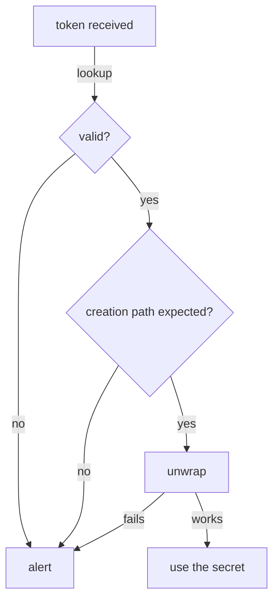

# Checking And Unwrapping A Wrapping Token

Response wrapping gives the receiver one guarantee: only one party can ever unwrap the token. That guarantee only helps if the receiver notices when it was not the first. A wrapping token that cannot be unwrapped, or one that comes from an unexpected path, means somebody may have read or replaced the secret on the way. This part shows the checks a receiver runs before it unwraps.

## Looking up a wrapping token

OpenBao lets anybody holding a wrapping token look it up, without unwrapping it. The lookup is done on `sys/wrapping/lookup` and returns the token's creation time, creation path and TTL. The endpoint needs no other token, so an application can check what it was given before it has any credentials of its own.

<!-- astrona:playground:renew -->

Create a wrapped secret ID, as a pipeline would, and keep the wrapping token in a variable. The `-field=wrapping_token` flag prints only the token:

```sh
WRAPPING_TOKEN=$(bao write -wrap-ttl=10m -f -field=wrapping_token auth/approle/role/inventory/secret-id)
bao write sys/wrapping/lookup token="$WRAPPING_TOKEN"
```

The lookup shows `creation_path` as `auth/approle/role/inventory/secret-id`, a `creation_time`, and `creation_ttl` of ten minutes. Nothing was unwrapped; the token is still valid.

## The checks, in order

The OpenBao documentation describes the receiver's checks in this order, and each failure has a meaning:

1. **Did a token arrive at all?** If the receiver expected one and none came, somebody may have taken it on the way. Raise an alert.
2. **Does the lookup succeed?** A failed lookup means the token was already unwrapped, has expired or was revoked. It may be a slow start, but it may be an interception. Raise an alert and check the audit log for who unwrapped it.
3. **Is the creation path the expected one?** If you expect a secret ID, the path must be the exact secret ID path of your role. A path that starts with `cubbyhole/` or `sys/wrapping/wrap` means someone may have unwrapped the real secret and wrapped something else. Check the whole path, not a prefix.
4. **Does the unwrap succeed?** If it fails now, treat it like a failed lookup.



The diagram shows that the secret is only used when every check passes, and that every failure leads to the same alert.

## Unwrapping and logging in

When the checks pass, the application unwraps the token and logs in with its role ID and the secret ID. Read the role ID, which is not secret, then unwrap and log in:

```sh
ROLE_ID=$(bao read -field=role_id auth/approle/role/inventory/role-id)
SECRET_ID=$(bao unwrap -field=secret_id "$WRAPPING_TOKEN")
bao write auth/approle/login role_id="$ROLE_ID" secret_id="$SECRET_ID"
```

The login returns a token with the policy `inventory-app`. Look up the wrapping token again:

```sh
bao write sys/wrapping/lookup token="$WRAPPING_TOKEN"
```

This time the lookup fails: the token was used up by the unwrap. If anybody else had unwrapped it first, your own unwrap would have failed in the same way, and you would know.

## Handing the result to a pod

In Kubernetes, the application usually reads its credentials from a Secret or a file. The unwrapped role ID and secret ID can go into a Kubernetes Secret that only the application's pods mount. Keep the unwrapped values in variables only as long as needed, and do not print them to a log:

```sh
kubectl -n clients create secret generic inventory-approle \
  --from-literal=role-id="$ROLE_ID" --from-literal=secret-id="$SECRET_ID"
```

A Kubernetes Secret is only base64-encoded, not encrypted, unless the cluster encrypts Secrets at rest. In production, an agent that unwraps the token inside the pod avoids storing the secret ID at all.

You now know how a receiver checks a wrapping token, what each failed check means, and how to finish the handover into an AppRole login. What is still open is the other end of a secret's life: how long the certificate or token you just issued stays valid, and how to end it early.

## Common pitfalls

> [!WARNING]
> - **Checking only a prefix of the creation path.** `auth/approle/` is not enough; check the exact path of your role.
> - **Ignoring a failed lookup.** It is the signal response wrapping exists to give you. Treat it as an incident until the audit log says otherwise.
> - **Generating a new secret ID when the handover fails.** That hides the incident. First find out who unwrapped the old one.
> - **Printing the unwrapped secret ID.** Command output ends up in logs. Use `-field` and variables, and clear them afterwards.
