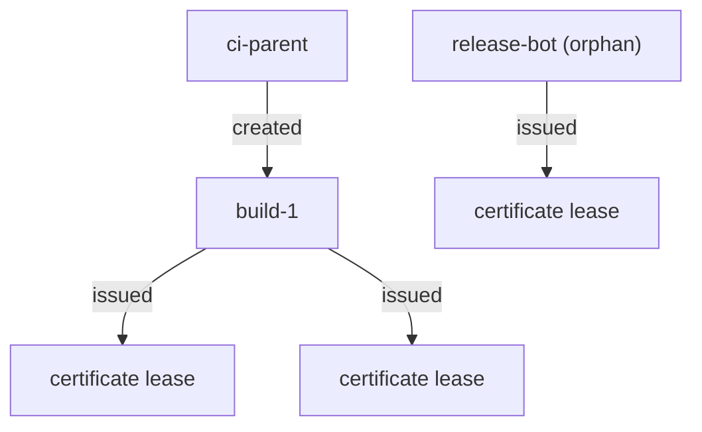

# Leases, Renewal And Revocation Trees

A certificate's private key is found in a public repository. A build token is pasted into a ticket. In both cases, the credential is valid until it expires, unless you end it now. OpenBao tracks every dynamic secret and every token with a **lease**, the time it is valid, and it can revoke one lease, every lease under a path, or a whole tree of tokens. This part shows all three, and the one rule that decides what a revocation takes with it.

## Leases on certificates

Some secrets engines create a lease for each secret they issue. The PKI role `web` in your playground has `generate_lease=true`, so each certificate it issues gets a lease, and revoking the lease revokes the certificate.

<!-- astrona:playground:renew -->

Issue two certificates and look at the lease of the first:

```sh
bao write pki/issue/web common_name=shop.inventory.local ttl=24h
bao write pki/issue/web common_name=api.inventory.local ttl=24h
```

Each response has a `lease_id` that starts with `pki/issue/web/`, a `lease_duration`, and the certificate's `serial_number`. List the leases under that path; this needs `sudo`, which the root token has:

```sh
bao list sys/leases/lookup/pki/issue/web
```

The list shows the last part of each lease ID. Look one up, using the full lease ID from an issue response; the value below is a placeholder:

```sh
bao lease lookup <LEASE_ID>
```

The lookup shows the lease's `issue_time`, `expire_time`, `ttl` and whether it is `renewable`.

## Renewing and revoking one lease

A renewable lease can be extended up to the maximum TTL of its mount or role; `bao lease renew <LEASE_ID>` asks for that. Certificates from the PKI engine cannot be renewed: an application asks for a new certificate instead. Revoking is the action you need after a leak:

```sh
bao lease revoke <LEASE_ID>
```

The command revokes this lease only. For a certificate, OpenBao also revokes the certificate and adds its serial number to the certificate revocation list (CRL). Reading the certificate by serial number shows a non-zero `revocation_time`; the value below is a placeholder:

```sh
bao read pki/cert/<SERIAL_NUMBER>
```

To revoke every lease under a path at once, for example after a whole role was misused, add `-prefix`: `bao lease revoke -prefix pki/issue/web`. That needs `sudo` and takes every certificate of the role with it, so use it only when that is what you mean.

## The token tree

Tokens are leased too, and they form a tree. A token created by another token is that token's **child**. When OpenBao revokes a token, it also revokes every child, their children, and every lease any of them created. An **orphan** token has no parent, so it survives when the token that requested it is revoked.



The diagram shows two separate trees: revoking `ci-parent` revokes `build-1` and its two certificate leases, while `release-bot` and its lease are not in that tree.

Build a small tree to see it. A token can only give a child policies it has itself, so the parent gets the policy it passes on. Save this as `pki-issuer.hcl`:

```hcl
path "pki/issue/web" {
  capabilities = ["update"]
}
```

Load it, create a parent and a child, let the child issue a certificate, then revoke the parent:

```sh
bao policy write pki-issuer pki-issuer.hcl
PARENT=$(bao token create -policy=pki-issuer -ttl=1h -field=token)
CHILD=$(BAO_TOKEN=$PARENT bao token create -policy=pki-issuer -ttl=30m -field=token)
BAO_TOKEN=$CHILD bao write pki/issue/web common_name=build.inventory.local ttl=1h
bao token revoke "$PARENT"
bao token lookup "$CHILD"
```

The last command fails: the child was revoked with its parent, and so was the lease of the certificate the child issued. `bao token revoke` has a `-mode` flag; `-mode=orphan` revokes only the token and turns its children into orphans, and `-mode=path` revokes by creation path. After a leak, the default, which revokes the whole tree, is usually what you want.

A token can also be revoked by its **accessor**, an identifier you can share without giving away the token: `bao token revoke -accessor <ACCESSOR>`. Incident reports and audit logs usually carry accessors, not tokens. Orphan tokens are created with `bao token create -orphan`, which needs `sudo` on the token creation path, or through an auth method role.

You can now find the leases under a path, revoke exactly one, and predict what revoking a token takes with it. Together with response wrapping, you control both the handover of a secret and the end of its life.

## Common pitfalls

> [!WARNING]
> - **Revoking with `-prefix` to stop one leak.** It revokes every lease under the path. Revoke the one lease ID instead.
> - **Using `-mode=orphan` after a leak.** The children of the leaked token stay valid. Use the default mode to revoke the tree.
> - **Creating a long-lived service token as the child of a person's token.** When that person's token is revoked, the service stops. Create service tokens as orphans or through an auth method role.
> - **Forgetting that the certificate itself is still in a file somewhere.** Revoking puts it on the CRL; clients must check the CRL for that to matter.

## Your mission: Hand Over An AppRole Secret ID And Revoke One Certificate

You can now check and unwrap a wrapping token and revoke a single lease. The mission gives you a wrapped secret ID to hand over to the inventory application, and three certificates of which one has leaked, and asks you to finish the handover and revoke only the leaked certificate.

The lab runs in its own cluster, so first pause your playground. Nothing in it is lost:

```sh
astrona stop ats-115-playground-030-01
```

Then start the lab:

```sh
astrona run --git ssh://git@github.com/astrona-io/ATS115.git -c sections/section-030/module-01/labs/lab-01
```

The task is on the next page. Solve it on your own first. When you think you are done, send it for grading:

```sh
astrona submit -c sections/section-030/module-01/labs/lab-01
```

When the lab is done, remove it and start your playground again:

```sh
astrona destroy ats-115-lab-030-01
astrona start ats-115-playground-030-01
```
