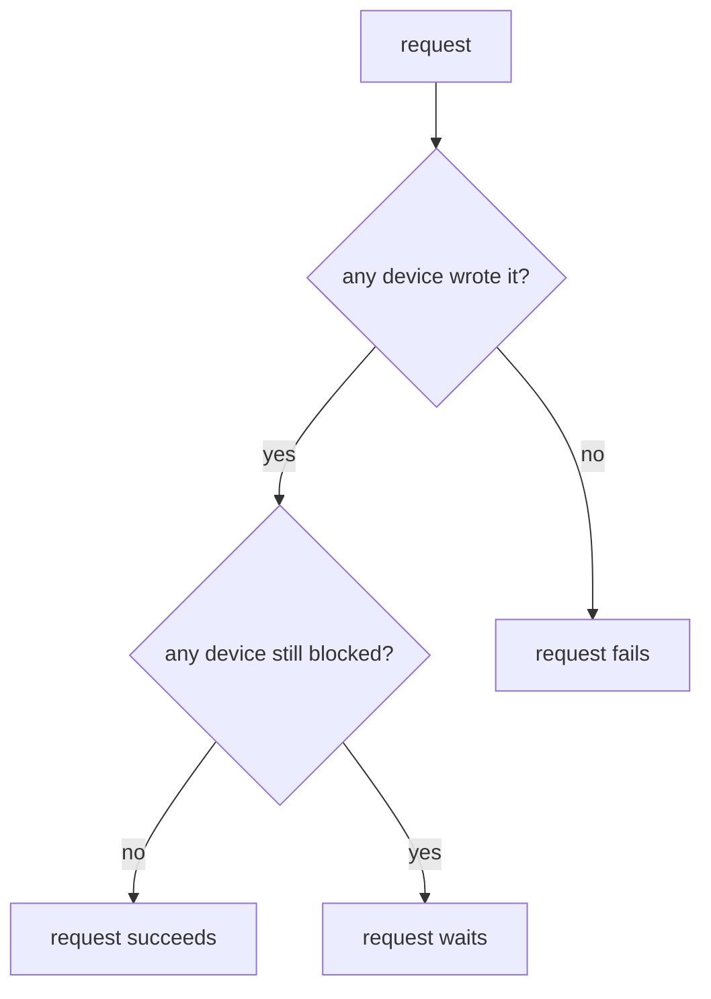

# Declarative Audit Devices And Blocked Logging

Audit devices created through the API can also be disabled through the API, by anyone with `sudo` on `sys/audit`. An attacker who gets such a token can switch off the record of what they do next. OpenBao 2.7 offers a stronger model: devices declared in the server configuration file, enabled at every start and changed only by changing the file. This part declares a device, applies the change to a Helm-installed server, and explains what OpenBao does when devices fail.

## The audit stanza

An `audit` stanza in the server configuration takes the device type and its path, a description, and an `options` block with the same options as `bao audit enable`:

```hcl
audit "file" "file-persistent" {
  description = "Audit log on the audit volume"
  options {
    file_path = "/openbao/audit/audit.log"
  }
}
```

OpenBao enables declared devices on the active node at start and when it receives `SIGHUP`. Removing the stanza disables the device. A declared device cannot be changed through the API, and it cannot use the same path as a device created through the API. Once all devices are declared, remove `unsafe_allow_api_audit_creation` from the configuration, so nobody can add or change devices through the API.

## Changing the configuration of a Helm-installed server

With the `openbao` Helm chart, the server configuration is the `server.standalone.config` value. The chart writes it to the ConfigMap `openbao-config`, under the key `extraconfig-from-values.hcl`, which the pod mounts. Two details of the chart matter here:

- The StatefulSet uses the `OnDelete` update strategy, so a `helm upgrade` does not restart the pod. The new configuration only applies after you delete `openbao-0`.
- A new pod starts **sealed**. It must be unsealed before it serves requests again, and before it enables the declared devices.

<!-- astrona:playground:renew -->

Start from the values currently in use:

```sh
helm get values openbao -n openbao -o yaml > openbao-values.yaml
```

Open `openbao-values.yaml` in an editor. In the `config` block under `server.standalone`, add the `audit` stanza from above after the line `ui = true`, and keep everything else. Then apply it and restart the pod:

```sh
helm upgrade openbao openbao/openbao --version 0.30.4 -n openbao --values openbao-values.yaml
kubectl -n openbao get configmap openbao-config -o jsonpath='{.data.extraconfig-from-values\.hcl}'
kubectl -n openbao delete pod openbao-0
```

The ConfigMap now contains the `audit` stanza. When the new pod is running, unseal it with the lab-only key; a real installation enters key shares or uses auto-unseal:

```sh
kubectl -n openbao exec openbao-0 -- bao operator unseal "$(kubectl -n openbao get secret openbao-init -o jsonpath='{.data.unseal-key}' | base64 -d)"
bao audit list -detailed
```

The port-forward stops when the pod is deleted; start it again before the last command. The list now contains `file-persistent/`, with the description from the stanza, next to the devices you created through the API.

## When devices cannot write

OpenBao treats audit records as essential: it does not answer requests that no device can record. Two kinds of failure behave differently:

| Failure | What OpenBao does |
| --- | --- |
| A device returns an error, and another device succeeds | The request succeeds; one record is enough |
| Every device returns an error | The request fails |
| A device never finishes its write (blocking), for example a TCP listener that accepts but never reads | Requests wait until the write completes, even when other devices succeeded |



The diagram shows that one successful device is enough, unless another device is stuck in the middle of a write. This is why the documentation recommends several devices, and why a TCP socket device needs a listener that is reliably read, with a `write_timeout`.

You now know how to declare audit devices so they survive restarts and cannot be changed through the API, how a configuration change reaches a Helm-installed server, and how OpenBao behaves when devices fail. Together with policies, identity, wrapping and leases, the audit log closes the loop: you decide who may do what, and you can prove afterwards who did it.

## Common pitfalls

> [!WARNING]
> - **Running `helm upgrade` and expecting the new configuration at once.** The chart uses `OnDelete`; delete the pod and unseal it.
> - **Declaring a device at a path an API-created device already uses.** The declared device cannot duplicate it; disable the API device first or use a new path.
> - **Leaving `unsafe_allow_api_audit_creation = true` after declaring devices.** The API can still add devices; remove the setting.
> - **One TCP socket device as the only device.** If the listener hangs, every request hangs. Keep a file device next to it.
